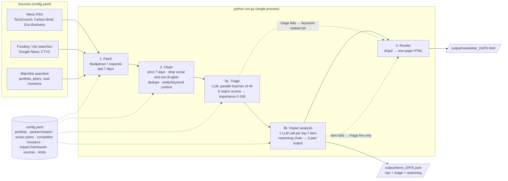
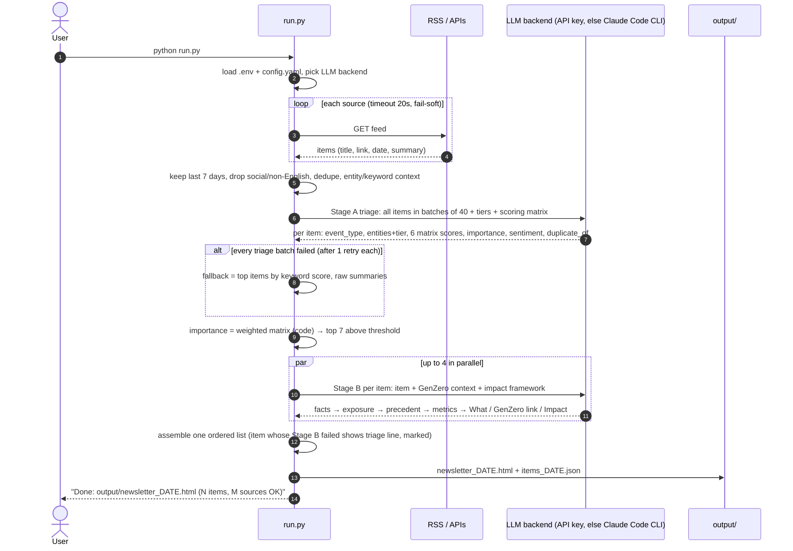
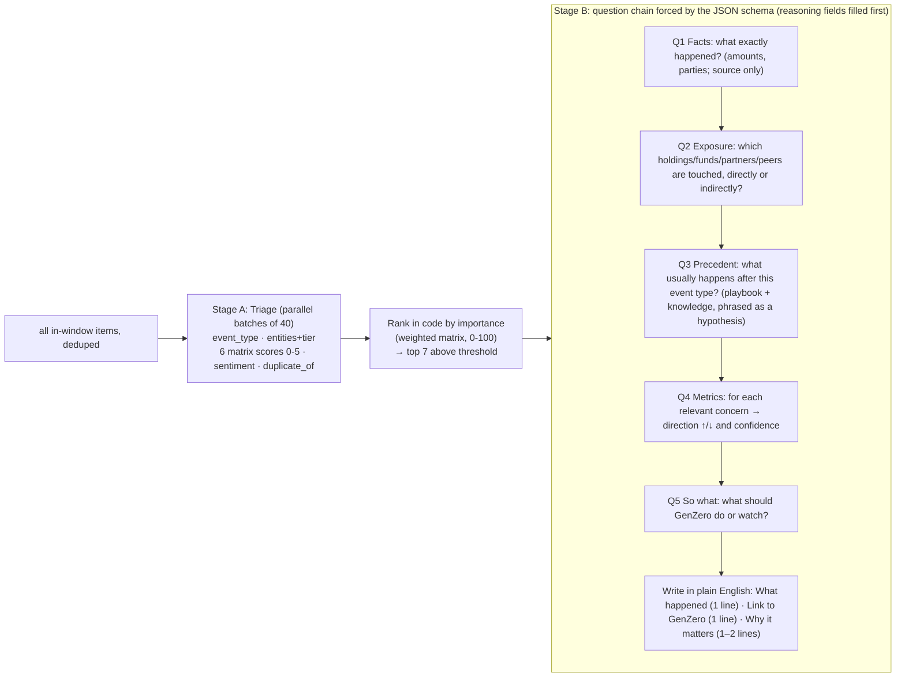
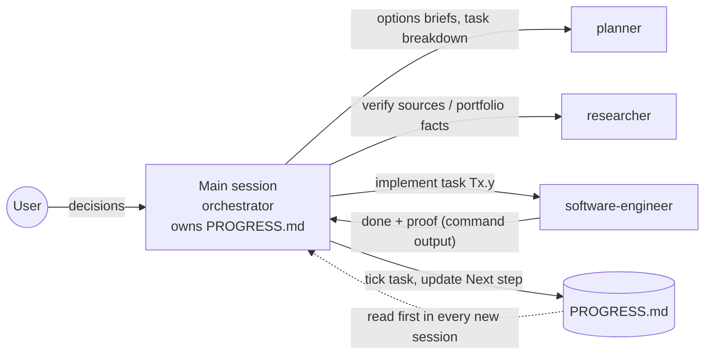

# PLAN: GenZero Weekly Climate-Tech Investor Newsletter

> Status: **v1 complete, verified and published** (2026-10-14). Repo: https://github.com/Benjamin-Fernandez/genzero-climate-newsletter
> Progress lives in `PROGRESS.md`. Rules for agents live in `CLAUDE.md`.

## 0. Current state of the project (2026-10-14)
| Area | State |
|---|---|
| Pipeline | Working end to end: `python run.py` → 8 RSS sources → ~120 in-window items graded → top 7 analysed → one A4 page (~2–2.5 min) |
| LLM backends | Any API key in `.env` (Anthropic, OpenAI, Gemini, OpenRouter, any OpenAI-compatible URL) → else local Claude Code CLI → else keyword-only page |
| Verified live | Claude Code CLI path (full runs, one-page check via Edge print-to-PDF, page order = importance order, no item older than 7 days) |
| Verified by tests only | API-key backends: 20 unit and mocked tests pass (`python -m pytest -q`); no live API key was available during development |
| Deliverables | `deliverables/REQUIREMENTS.md` (≤10 lines), `deliverables/README.md` (≤5 entries), `output/newsletter_2026-10-14.html` (sample), runnable code |
| Fixed rules | Strict 7-day window; social-media posts never included; ranking only by the importance matrix (no quotas) |
| Known gaps | Headline/snippet-only input; Google News RSS is unofficial; scores vary a few points between runs; peer lists partly unverified |

Task-level history and next steps: `PROGRESS.md`.

## 1. Goal (one sentence)
Running `python run.py` once a week produces a **one-page HTML newsletter** for GenZero's CEO and CIO.
Each item says what happened in climate tech this week and **why it matters to investors and GenZero's
portfolio**, with competitor/sector/peer fundraises and negative news given priority.

## 2. Design principles
1. **Working before clever.** It is a 4-stage linear pipeline in one Python process, with no database, server, scheduler or framework.
2. **Fail soft.** One dead source or a failed LLM call degrades the newsletter; it never crashes the run.
3. **LLM for judgement only, and judgement is structured.** Code does fetching, filtering, ranking and layout.
   Claude does triage and the investor-impact analysis. "Why it matters" is the crux of the product, so it comes from a fixed
   reasoning chain and an investor-concern framework (§5), never from a one-line "summarise this" prompt.
4. **Config over code.** Sources, portfolio companies, competitors and limits live in `config.yaml`, so next
   week's changes don't need code edits.
5. **Auditable.** Every run saves the raw items and the LLM's JSON next to the HTML. This lets you explain
   why something was included and debug bad output.

## 3. System overview



### One run, step by step



### Newsletter layout (one A4 page, plain list, revised 2026-10-14)
Plain and simple, the way a briefing note looks: **one numbered list ordered by importance**, with no categories, tags, icons or
decorative styling. Black text on white, simple font, one A4 page.
```
GenZero Climate Tech News: week of 14 Oct 2026

1. Headline of the article (linked) (Source name)
   What happened:    1 line, the main news (facts from the source only)
   Link to GenZero:  1 line, how it relates to GenZero (e.g. "Competitor of BeZero Carbon, a GenZero investment")
   Why it matters:   1–2 lines, the likely effect on GenZero's investments and why it is important

2. ...
(up to 7 items)

Sources: Google News (funding, negative, portfolio, peers), TechCrunch Climate, CTVC, Carbon Brief, Eco-Business · Auto-generated, check sources before forwarding.
```
**Hard rules:** every item uses exactly these three labelled parts. Plain English, no jargon or unexplained acronyms
(say "valuations of similar companies", not "comps"). Order = importance score from the weighted matrix (§5.2b). Categories are still used internally for ranking and the audit JSON, but they are never shown.

## 4. Sources (DECIDED: 8 RSS feeds, see Chosen set)
The researcher agent live-tested 17 candidates from this machine on 2026-10-14. None of them needs an API key.

### Access method comparison
| Method | Stability | Speed to build | Funding / negative-news coverage | ToS risk |
|---|---|---|---|---|
| **Publisher RSS** | High; fast (<2 s), URLs rarely change | Fastest (one parser for all) | Medium (TechCrunch, CTVC strong) | Low: published for syndication |
| **Google News RSS search** | Good in tests, but undocumented and could change | Fast (same parser, any keyword query) | **Highest**: keyword queries catch rounds *and* bad news across hundreds of outlets | Medium: unofficial endpoint, redirect links |
| Free APIs (GDELT, arXiv) | GDELT poor (429 rate limits, empty results); arXiv fine | Medium (custom schema each) | GDELT noisy; arXiv none | Low |
| HTML scraping | Low: layouts change, bot walls (UNFCCC, Axios) | Slowest (selectors per site) | Site-dependent | Highest |

### Tested sources that work
| Source | Type | Feed | Items | Content | Notes |
|---|---|---|---|---|---|
| Google News: **funding** query | Funding (aggregator) | `news.google.com/rss/search?q=(climate OR cleantech OR decarbonization OR "carbon removal") ("series a" OR "series b" OR "seed round" OR raises) when:7d&gl=SG` | ~30 | Title + publisher | Found real rounds (e.g. CarbonFarm $7.8M A, 1KOMMA5° €70M). "raises" alone also matches "raises questions", so the query needs tightening |
| Google News: **negative** query | Risk (aggregator) | same endpoint, `(cleantech OR "climate tech" OR hydrogen OR "carbon capture" OR "offshore wind") (bankruptcy OR cancelled OR layoffs OR "shuts down" OR scrapped) when:7d` | 16–59 | Title + publisher | Caught bankruptcies, offshore-wind cancellations, hydrogen insolvency |
| TechCrunch Climate | News / funding | `techcrunch.com/category/climate/feed/` | 20 | ~140-char snippet | Startup raises; filter out event promo posts |
| CTVC (Sightline) | Funding / deals | `ctvc.co/rss/` | 15 | Full text | Weekly curated deal roundups and market context |
| Carbon Brief | Policy / research | `carbonbrief.org/feed/` | 12 | Full text | Policy + science; low volume, high quality |
| Eco-Business | News (Asia) | `eco-business.com/feeds/news/` | 20 | Snippet | **Only working Asia/ASEAN source.** Relevant to Singapore |
| Canary Media | News / policy (US) | `canarymedia.com/rss.rss` | 100 | Snippet | Good for US policy rollbacks (negative news) |
| EC Climate Action | Policy (EU) | `climate.ec.europa.eu/node/2/rss_en` | 30 | Snippet | Official, low frequency |

### Rejected (reason)
Axios Pro Climate Deals (Cloudflare 403 + paywall) · IEA (no RSS; scraping only) · UNFCCC (bot wall,
empty RSS) · GDELT (429 rate limits, empty results) · arXiv (academic, not exec-relevant) · Carbon Herald
(intermittent WAF 403s; could be an optional extra) · CleanTechnica / Electrek (EV consumer noise) · Trellis
(corporate ESG, little funding news).

### Chosen set (8 feeds, 5 types)
1. Google News **funding** query: funding
2. Google News **negative** query: risk / negative news
3. TechCrunch Climate: news / funding
4. CTVC: deals / market
5. Carbon Brief: policy / research
6. Eco-Business: Asia news (Singapore relevance)
7. Google News **portfolio watchlist**: portfolio companies + partners (added 2026-10-14, T2.7)
8. Google News **peers watchlist**: sector peers + rival investors (added 2026-10-14, T2.7)

Note: Google News ignores `when:7d` when a query has many OR terms, so watchlist queries are generated from config in chunks of ≤4 names.

Why: all of these are RSS, so there's one parser, no keys and no scraping. The two Google News queries
target the brief's emphasis on fundraises and negative news directly. The publisher feeds add depth
and curated context. Implementation notes: use `requests` (it bundles CA certs, which avoids the local SSL
issue seen with `urllib`) with an honest User-Agent; dedupe by normalised title because Google News repeats stories.

## 5. LLM step: the investor impact engine
**Runtime:** any LLM API key in `.env` is used first; otherwise the local Claude Code CLI runs headless
(`claude -p --output-format json --json-schema <schema> --model sonnet`, binary resolved via `CLAUDE_BIN` → PATH → newest VS Code
extension); with neither, a keyword-only newsletter is produced. Details in §5.0. Prompts live in `newsletter/prompts/*.md`, so
they can be improved without touching code. All LLM access goes through `providers.complete_json()`.

### 5.0 LLM backends (added 2026-10-14 for hand-over)
The receiver may not have VS Code or the Claude CLI, so **any LLM API key wins over the CLI**. Detection order (first match):
`LLM_PROVIDER` (explicit) → `ANTHROPIC_API_KEY` → `OPENAI_API_KEY` → `GEMINI_API_KEY`/`GOOGLE_API_KEY` → `OPENROUTER_API_KEY` →
`LLM_BASE_URL` (+`LLM_API_KEY`; any OpenAI-compatible API incl. DeepSeek, Groq, Mistral, local Ollama) → local Claude Code CLI →
none (keyword-only newsletter and a clear message). Keys come from env vars or a `.env` file (template: `.env.example`).
`LLM_MODEL` overrides the model; defaults: Anthropic `claude-opus-5-5`, OpenAI `gpt-5`, Gemini `gemini-2.5-flash`, CLI `sonnet`.
- **Anthropic:** official `anthropic` SDK, streaming, structured outputs (`output_config.format` json_schema), effort medium (triage) /
  high (impact), server-side refusal fallback (`fallbacks: "default"`). No forced tool use (it 400s on current models).
- **OpenAI-compatible:** official `openai` SDK, `response_format` json_schema → json_object → plain-JSON prompt, degrading step by step.
- All backends sit behind one function `providers.complete_json(prompt, schema, timeout, effort)`. Schemas are sanitised to the
  common supported subset; length and range limits are enforced in code.

| Option considered | Pros | Cons |
|---|---|---|
| **Official SDKs: anthropic + openai (chosen)** | One `openai` client covers OpenAI, Gemini, OpenRouter, Groq, DeepSeek and local models; reliable structured output | Two extra pip deps |
| LiteLLM | One library for 100+ providers | Heavy dependency, more moving parts, slower installs |
| Raw HTTP per provider | No deps | More code to maintain; reimplements retries |

### 5.1 What Claude knows: context tiers (`config.yaml`)
| Tier | Example | Shown on page as | Why it is tracked |
|---|---|---|---|
| `portfolio` | Velocys, BeZero Carbon, CIX, funds (BEV, EIP…) | stated in "Link to GenZero" | Direct exposure: marks, follow-ons, exits |
| `partners_watch` | ACEN, Keppel, Mizuho, Green Fuel Forward, C-Quest (exited) | "partner of GenZero" | Counterparty and reputational risk, not holdings (D6) |
| `sector_peers` | Peers of each holding (e.g. BeZero → Sylvera, Calyx Global) | "competitor of X, a GenZero investment" | Peers' raises, failures and exits move our holdings' valuation comps and competitive position |
| `competitor_investors` | Brookfield BGTF, TPG Rise Climate, Just Climate… | "rival climate investor" | Competition for deals, LP appetite, co-investment |
| `keywords` | SAF, biochar, rice methane, Article 6… | "same sector as X" | Sector-level signal |
Source: `docs/research/portfolio.md` and `docs/research/impact_framework.md` (researcher, with URLs).

### 5.2 Investor impact framework (pre-prompt, `config.yaml → impact_framework`)
A system-level "pre-prompt" gives Claude the lens a climate investor actually uses. It has two parts,
both researched with sources (T0.7):
- **Concern checklist** (~10 metrics, each with a question Claude must answer). Examples: valuation and comparable marks · follow-on
  capital and dilution · exit routes (M&A/IPO multiples) · revenue, demand and offtake · unit economics, cost curve and tech risk ·
  carbon-credit price, demand and integrity · policy and regulatory exposure (Article 6, CORSIA, subsidies) · competitive position ·
  counterparty and reputational risk · deal pipeline and co-investment opportunity · project execution.
- **Event playbook** (~10 event types → what *usually happens next*, which metrics move and which way, real precedents).
  For example: *peer large fundraise* → sector comps reprice up, more competition for deals; *sector insolvency or layoffs* →
  comps marked down, follow-on capital tightens, distressed M&A opportunities appear (precedent: Northvolt);
  *carbon-integrity scandal* → VCM prices and demand fall, ratings/MRV demand rises (precedent: 2023 REDD+ controversy).

### 5.2b Importance scoring matrix 
Ranking is **only** by an importance score (0–100). Claude grades each news item on 6 criteria (0–5 each, against written
level descriptions); code computes the weighted total, and **the top scorers are always the ones displayed** (max 7, in score order).
There are no quotas, slot reservations or category limits. Only duplicates of the same story are removed. The matrix lives in `config.yaml → scoring_matrix`,
so weights and descriptions can be tuned without code. The triage prompt is generated from it.

| Criterion | Weight | Question Claude answers | 5 means… | 0 means… |
|---|---|---|---|---|
| Exposure to GenZero | 30 | How directly does this touch GenZero? | names a portfolio company or fund | no link |
| Financial materiality | 10 | How much money or value is at stake? | >US$500M, or directly changes a holding's value | no financial angle |
| Downside risk | 30 | How serious is the negative signal? | failure, fraud or cancellation at a holding, partner or direct competitor | neutral or positive |
| Investment-case signal | 15 | Does it change the case for a GenZero sector (policy, prices, demand, cost)? | binding policy or big price shift in a focus sector or Singapore/ASEAN | none |
| Actionability | 10 | Should GenZero act or check something now? | act this week (deal, co-invest, risk review) | nothing to do |
| Specificity | 5 | How concrete and credible is it? | confirmed facts with numbers, reputable source | unverifiable |

`importance = Σ weight × score / 5`. Code recomputes it, and its value is authoritative; a mismatch with Claude's own total is logged.
Negative news gets its priority from the 30-point *Downside risk* criterion (weights re-tuned by the user to 30/10/30/15/10/5), not from reserved slots.
Items scoring below `min_score_to_show` (default 30) are never shown, so a quiet week shows fewer items instead of filler.
Every item's six scores and a one-line reason are saved in `items_DATE.json` for audit ("why was X shown above Y?").

**Pros:** transparent and explainable to the CEO/CIO; one tunable place; deterministic ordering. **Cons:** per-criterion grading
from headlines can be noisy (mitigated by specificity weighting and the audit trail). Weights are a judgement call to revisit after a few weeks.

### 5.3 Multi-prompt chain

- **Why two stages:** triage grades *all* items in parallel batches of 40 (with cross-batch dedupe). Impact analysis needs
  *focused* reasoning per item, which suits one call per item. Deep analysis only runs on the 7 items that make the page, which keeps it fast
  (~2–2.5 min in total with the Claude CLI).
- **Why the reasoning fields sit in the schema:** forcing Q1–Q5 to be answered *before* the three output lines makes the
  final "Impact" line come out of exposure, precedent and metrics rather than generic text. The reasoning is saved to `items_DATE.json`
  for audit (useful when the CEO asks "why do you say that?") but is not printed.
- **Guardrails in the prompt:** facts come only from the item text. Precedent claims are phrased as hypotheses ("typically", "likely").
  A company is called a holding only if it is in `portfolio`. If there is no credible link, Claude says so and the exposure score drops, so the item falls off the page.
  Impact must name ≥1 concern from the checklist and a direction. Banned: "this is significant", "highlights the importance", and similar filler.
  **Plain English:** the three visible lines must read clearly to a CEO. No investor jargon or unexplained acronyms ("comps", "MOIC", "VCM" → spell out
  or rephrase). The framework's metric names are used for reasoning only and are translated into plain words in the output.
- **Fallbacks:** if Stage A fails, the page uses a keyword-ranked list. If Stage B fails for one item, that item shows its triage-level line marked
  "(quick take)". A newsletter is always produced.

## 6. Design decisions

### Requirements Given
| Decision | Choice | Why |
|---|---|---|
| Language | Python 3.12 (installed) | Best feed/HTML libs, fastest to build |
| LLM runtime | **Any LLM API key first** (Anthropic → OpenAI → Gemini → OpenRouter → any OpenAI-compatible URL), then the local Claude Code CLI as a fallback; with neither, a keyword-only newsletter | Started as CLI-only (your instruction); API keys were added so a receiver without VS Code or the Claude CLI can run it with a key in `.env`. See §5.0 |
| LLM libraries | Official `anthropic` SDK (Claude) and `openai` SDK (all OpenAI-compatible APIs) | Reliable structured JSON output and built-in retries; one `openai` client covers most providers |
| Secrets | Read from env vars or a git-ignored `.env` (template `.env.example`); never logged or committed | Safe to publish the repository |
| Output | Static HTML file in `output/` | Brief says "delivered as HTML". Opens in any browser, prints to one page |
| Trigger | One command, manual (`python run.py`) | Brief requirement; scheduling is a future improvement |
| Storage | Flat files (JSON) | No DB needed for a weekly batch of <200 items |


### D2 (DECIDED: A, later revised to C as built): How many LLM calls per run?
| Option | Pros | Cons |
|---|---|---|
| A. One batched call (all ~60 items → one JSON) | Simplest; ~1–2 min; Claude sees all items together, so it can merge duplicate stories and rank relative to each other | One bad response affects everything (mitigated: 1 retry + keyword fallback); large prompt |
| B. One call per item | Isolated failures; easy to parallelise | ~60 CLI launches (each ~5–10 s of start-up) → 5–10 min; no cross-item comparison; more usage |
| **C. Two-stage: triage all → deep analysis of top items (as built)** | Best quality per item; less wasted writing | Two prompts to maintain; more moving parts |

As built: triage runs in parallel batches of 40 (A's batching), then one impact call per top-7 item (C). See §5.3.

### D3 (DECIDED: A): What text does the LLM read?
| Option | Pros | Cons |
|---|---|---|
| **A. RSS title + summary only**  | Fast, stable, no paywall/ToS issues, no HTML parsing | Summaries can be thin, so "why it matters" relies on Claude's background knowledge (risk of generic lines) |
| B. Also fetch full article text for the top ~10 items | Richer, more specific blurbs (amounts, investors) | Paywalls, bot blocking, HTML extraction bugs; slower; needs `trafilatura`/readability dependency |
Upgrade path: A now, then B for the top items only in v2.


## 7. Project layout (current)
```
genzero-climate-newsletter/
├── deliverables/
│   ├── README.md           # setup, sources used/rejected, how it works, limitations (≤5 entries)
│   └── REQUIREMENTS.md     # confirmed requirements (≤10 lines)
├── CLAUDE.md  PLAN.md  PROGRESS.md   # agent rules, design + current state, task log
├── config.yaml             # sources, tiers, impact framework, scoring matrix, limits, LLM defaults
├── .env.example            # copy to .env and paste ONE LLM API key (.env is git-ignored)
├── requirements.txt        # feedparser, requests, jinja2, pyyaml, anthropic, openai, pytest
├── run.py                  # entry point: python run.py [--no-llm]  (window fixed at 7 days)
├── newsletter/
│   ├── fetch.py            # RSS sources → normalised items, strict 7-day window
│   ├── watchlist.py        # builds Google News watchlist queries from config (≤4 names per query)
│   ├── clean.py            # drop social/non-English/noise, dedupe, entity/keyword context
│   ├── providers.py        # LLM backend detection (.env), Anthropic + OpenAI-compatible + Claude CLI, JSON parsing
│   ├── llm.py              # Stage A triage (matrix), ranking, Stage B impact, fallbacks
│   ├── prompts/            # triage.md, impact.md, editable without code
│   ├── render.py           # Jinja2 rendering
│   └── template.html       # one-page A4 plain-list layout
├── tests/test_providers.py # backend detection, .env, schema, mocked Anthropic calls, JSON parsing
├── docs/research/          # portfolio.md, impact_framework.md (sourced reference data)
├── output/                 # newsletter_DATE.html (sample committed), items_DATE.json (git-ignored)
└── .claude/                # agents (planner, researcher, software-engineer) + enhance-prompt skill
```

### How the agents build it


## 8. Where it can fail (and the mitigation)
| Failure | Effect | Mitigation in v1 |
|---|---|---|
| A feed changes URL / goes down | Fewer items | Per-source try/except; footer lists which sources succeeded; ≥3 sources gives redundancy |
| Quiet news week | Thin newsletter | Strict 7-day window (never looks further back, by user requirement); items below the score threshold are hidden, so fewer items are shown rather than filler |
| No API key and no Claude CLI / invalid key / usage limit | No analysis | Clear message at startup; keyword-ranked fallback newsletter still produced |
| LLM returns invalid JSON | No analysis | Schema-enforced output (CLI `--json-schema`, Anthropic structured outputs, OpenAI `response_format`), tolerant parsing, 1 retry, then fallback |
| LLM hallucination (wrong amount, invented portfolio link) | Misleading item | Blurbs are built only from the provided summary; every item links to its source; footer: "verify before forwarding"; raw JSON saved for audit |
| Generic "why it matters" | Low value to CEO | Impact framework pre-prompt + forced Q1–Q5 reasoning chain + banned-filler rule + must name a metric and direction; D3-B upgrade |
| Wrong precedent or over-confident hypothesis | Misleading call | Precedents phrased as hypotheses; reasoning saved for audit; footer disclaimer |
| Page overflow | >1 page | Hard caps (7 items; What ≤150, link ≤150, Impact ≤300 chars) + print CSS; check in print preview |
| Same story from 3 sources | Repetition | URL + title-similarity dedupe; Stage A `duplicate_of` merges the rest |
| Stage B slow (7 CLI calls) | Run takes minutes | ≤4 parallel; per-call timeout; failed item falls back to quick take |
| Non-Claude provider behaves differently | Weaker or malformed output | Schema sanitised to a common subset; json_schema → json_object → plain-JSON fallback chain; tested with mocks only, so check the first live run |

## 9. Future improvements (explicitly NOT in v1)
Live-test each API provider · full-text extraction · cross-week "already reported" memory · email delivery · Windows Task
Scheduler / cloud cron · paid deal databases (PitchBook, Crunchbase, Sightline) · portfolio list
synced from an internal source · evaluation set to measure relevance quality.

## 10. Decision log
| Date | Decision | Reason |
|---|---|---|
| 2026-10-14 | Python, flat files, manual one-command run | Simplest path to a working model |
| 2026-10-14 | LLM = local Claude Code CLI headless (`-p --json-schema`) | User instruction; verified flags exist in CLI 2.1.299 |
| 2026-10-14 | D1 Sources: Google News (funding + negative queries), TechCrunch Climate, CTVC, Carbon Brief, Eco-Business | All RSS, live-tested, no keys; directly targets fundraises + negative news; Asia angle |
| 2026-10-14 | D2 One batched Claude call (+1 retry, keyword fallback) | Simplest, fast, allows cross-item dedupe/ranking |
| 2026-10-14 | D3 RSS title + summary only | Stable, no scraping; full text is a v2 upgrade |
| 2026-10-14 | D4 Local `enhance-prompt` skill instead of ECC | ECC not installed; lightweight and project-specific |
| 2026-10-14 | D6 Exited/non-investment partners → `partners_watch` tier | Surface risk news without mislabelling holdings |
| 2026-10-14 | D2 revised → two-stage: batched triage + per-item impact analysis with a researched impact framework | User: "why it matters" is the crux; must use structured multi-prompt reasoning on investor metrics, not fluff |
| 2026-10-14 | Fixed 3-part item format (What / GenZero link / Impact), max 7 items | User requirement; 7 × 5 lines fits one A4 page |
| 2026-10-14 | Track `sector_peers` (competitors of each holding) as a context tier | User requirement; peers' raises and failures move holdings' comps |
| 2026-10-14 | Layout → plain numbered list ordered by importance; no categories, tags, icons or decorative styling; plain-English labels | User: previous layout too jargon-heavy and too polished |
| 2026-10-14 | Add 2 watchlist Google News queries (portfolio+partners; peers+competitor investors), generated from config | Implements 'track similar companies/competitors'; general feeds rarely name GenZero entities |
| 2026-10-14 | Ranking: min relevance 3, negative bonus only when relevant, ≤2 per event type, explicit 0–5 rubric | First real run showed irrelevant bad news outranking GenZero-sector deals |
| 2026-10-14 | T2.8 slot/quota rules REJECTED by user | User: don't cap competitor news or reserve slots for bad news or holdings |
| 2026-10-14 | Ranking = weighted importance matrix graded by Claude (6 criteria, weights 30/20/20/15/10/5), top scorers always shown | User requirement; transparent and tunable in config |
| 2026-10-14 | Strict 7-day window, no `--days` override, undated items dropped | User: a quiet week must not look past 7 days |
| 2026-10-14 | Every in-window item is graded by the matrix (parallel triage batches of 40, safety cap 200); keyword score is context only, never a cut | A keyword pre-cut to 60 silently removed most negative news, contradicting 'top matrix scorers are shown' |
| 2026-10-14 | Social-media posts (Facebook, X, LinkedIn, YouTube, TikTok, Reddit…) always excluded, hardcoded in `clean.py` with no config option | User: there must never be an option to include social posts |
| 2026-10-14 | API-key backends (Anthropic SDK; OpenAI-compatible SDK for OpenAI/Gemini/OpenRouter/any base URL) take priority over the Claude CLI; `.env` support | User is submitting the project; the receiver may not have VS Code or the Claude CLI |
| 2026-10-14 | Matrix weights re-tuned to 30/10/30/15/10/5 (exposure, materiality, downside risk, investment-case signal, actionability, specificity) | User edit: downside risk weighted equal to exposure, money at stake reduced |
| 2026-10-14 | README and REQUIREMENTS moved to `deliverables/`; requirements.txt annotated; §0 current-state section added | User request for hand-over |
